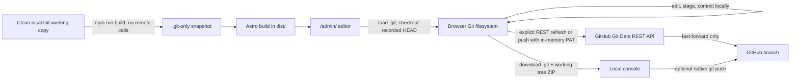

# Astro CMS design

**Status:** Implementation complete; authenticated GitHub push requires a user PAT for end-to-end verification
**Decision:** Embed a `.git`-only snapshot of the current local repository in the static build. The browser checks out `HEAD`, edits and commits locally, then either explicitly pushes local commits to GitHub via REST with a user PAT or downloads the full working repository for a console push.

## 1. Architecture at a glance



The browser contains a real local Git working repository, not a mock working-tree map. The initial static snapshot contains Git metadata and objects only; browser checkout materializes the files. There is no remote clone/fetch/pull or Git transport. Export preserves browser-created commits for native Git push.


## 2. Build-time Git snapshot

Add a local Node build step, for example `scripts/embed-repository.mjs`, before `astro build`. It reads the current checkout and never contacts a Git remote.

The build archive contains the local `.git` directory only; the working tree is not duplicated. Git objects contain the committed file contents, and `HEAD` plus the current branch identify which tree the browser must materialize. Require a clean worktree so the snapshot cannot silently omit edits.

Recommended build procedure:

1. Require a normal, non-bare clone on a named branch with full history. Before building, require a clean source tree; ignored generated `dist/` output, `base-git.zip`, and the snapshot sidecar are not source changes.
2. Package the repository’s `.git` directory as `public/admin/base-git.zip` with metadata (schema version, base SHA, branch, and build time). Write the same metadata to `public/admin/snapshot.json` so the browser can detect a newer base without downloading the archive. Do not copy the worktree into the initial ZIP.
3. Ensure the snapshot is self-contained and supported by the browser Git library: include the object database, refs, `HEAD`, index, and repository config needed for local checkout and commits. Reject linked worktrees, object alternates, shallow history, submodules, Git LFS, SHA-256 object format, and other unsupported layouts rather than emit a partial repository.
4. Require generated output (`dist/`), `.astro`, `node_modules`, `public/admin/base-git.zip`, and `public/admin/snapshot.json` to be ignored and untracked at `HEAD`; fail if they are tracked. Because the snapshot preserves full history, older commits may still contain such files.
5. Astro copies both generated assets to `dist/admin/`. The default local build and the `/astrocms/` Pages build must reference them through the configured base path.

Use a small cross-platform ZIP library such as `fflate` for build-time packaging and browser-side extraction/repackaging. Since the initial archive preserves `.git` history, verify generated output is untracked at `HEAD`; do not claim to remove files from historical Git objects.

On first initialization in an empty persistent browser filesystem, fetch the small snapshot sidecar, fetch and unpack `.git` from `base-git.zip`, open it with `isomorphic-git`, and force-checkout the recorded branch at `HEAD` to create the working tree. Record that initialization completed; subsequent page loads reuse saved state, compare its base SHA with the sidecar, and warn on staleness without overwriting local edits. Use a browser-backed filesystem such as LightningFS/IndexedDB, flush mutations before acknowledging them, and keep Git work off the UI thread. The dependency set is `isomorphic-git`, `@isomorphic-git/lightning-fs`, `fflate`, and the `buffer` browser polyfill; Vite aliases `buffer` to `buffer/` and `global` to `globalThis` for Worker compatibility. No browser HTTP Git plugin is needed.

The final download is different from the initial snapshot: it contains the browser’s complete working tree and `.git` state, including new commits. The owner can unpack it as a normal working copy and use native Git. Keep the clean-tree build requirement so the embedded index, `HEAD`, and checkout are consistent.

## 3. Content files and Astro rendering

The current starter has no content model. Store menu configuration as standalone YAML under `src/data/menus/`, and use Astro content collections for Markdown blog posts and generic pages. Define a `menus` collection with Astro’s `glob()` loader rooted at `src/data/menus` to parse and validate those YAML files. Astro’s loader supports YAML, and collections are data until a page route explicitly renders them ([Content Collections guide](https://docs.astro.build/en/guides/content-collections/)).

Proposed layout:

```text
src/
├── components/
│   └── SiteHeader.astro
├── content.config.ts
├── content/
│   ├── blog/
│   │   └── <slug>.md
│   └── pages/
│       └── <slug>.md
└── data/
    └── menus/
        └── main.yaml
```

Example `src/data/menus/main.yaml`:

```yaml
title: Main navigation
items:
  - label: Home
    href: /
  - label: Journal
    href: /journal/
```

The menu YAML file has no URL of its own; its `items` contain link destinations. `SiteHeader.astro` is the rendering component and reads the menu data. The admin edits the standalone YAML text; it is not Markdown with frontmatter.

Blog entries use frontmatter such as `title`, `pubDate`, `description`, and `draft`, followed by a Markdown body. Generic pages use a title and optional description plus Markdown. Astro page routes render content entries at build time ([Routing guide](https://docs.astro.build/en/guides/routing/)).

The admin route is `src/pages/admin/index.astro`, producing the reserved `/admin/` route. The `menus` collection is data-only; it does not create a URL unless an Astro page explicitly renders it.

## 4. Browser Git workspace

The admin page is static HTML plus client-side JavaScript; no server adapter or Git proxy is needed. The browser contacts GitHub only after an explicit push or refresh action.

- Load and unpack the embedded `.git` snapshot into browser-backed storage, then checkout the recorded branch at `HEAD` to materialize the source files.
- Show Menus, Blog posts, and Content lists as focused views, plus a Files view covering all checked-out repository paths.
- Edit menu YAML and Markdown/frontmatter with a plain text editor; also edit other text files, including code and configuration.
- Preview common image formats; upload/replace and download binary assets.
- Create, rename, move, and delete files through explicit actions; deletion requires confirmation. Saving writes changes into the browser’s working tree.
- Use `git.status`/status matrix to show modified, untracked, and deleted files. New content files use their collection paths, while Files can create anywhere in the repository.
- Commit locally using `git.add` and `git.commit`. Collect commit message and author name/email in the UI; multiple commits are supported.
- “Push to GitHub” sends the missing local commit chain through the Git Data REST API. It uses a user-supplied fine-grained PAT with repository `Contents: write`, held only in memory for the push. No Git smart-HTTP fetch/pull or force push; the ref update is fast-forward only.
- “Refresh from GitHub” fetches the configured branch through Git Data REST using a fine-grained PAT with `Contents: read`. It rejects dirty worktrees and only fast-forwards when upstream descends from local `HEAD`; it preserves local commit history and refuses divergence.
- Persist the repo and local commits in IndexedDB so a reload does not reset the branch. Show a clear export/backup reminder because browser storage can be cleared or evicted.
- “Download repository” zips the current working tree and `.git` state, including local commit objects and refs.

The initial UI uses the branch checked out at build time. It does not switch branches or use Git smart-HTTP fetch/pull; upstream synchronization is an explicit REST fast-forward.

## 5. Publishing: GitHub REST and console fallback

Unpacking the downloaded ZIP produces a Git working copy. The owner can run:

```sh
git status
git log --oneline -5
git push origin <current-branch>
```


The explicit browser push uses [GitHub blob](https://docs.github.com/en/rest/git/blobs), [tree](https://docs.github.com/en/rest/git/trees), [commit](https://docs.github.com/en/rest/git/commits), and [reference](https://docs.github.com/en/rest/git/refs) endpoints. It creates missing objects in local commit order, verifies returned SHAs, then updates the branch ref with `force: false`. The fine-grained PAT needs repository `Contents: write`, is used only for that action, and is never stored.

Refresh uses GitHub REST `GET` endpoints for refs, commits, trees, and blobs. It imports and verifies missing objects, then fast-forwards the browser branch only if the remote head descends from local `HEAD` and the worktree is clean. The refresh PAT needs `Contents: read`; a `Contents: write` token also works. PATs are memory-only and never exported.

The export preserves repository configuration from the `.git` snapshot. The owner can instead push it from the console using their normal Git setup; browser REST push is optional and never automatic.

If the GitHub branch has diverged from local history, refresh and push abort without updating refs. The owner resolves the divergence in the console. Neither action force-pushes.

## 6. Public snapshot decision

The initial `.git` archive is a public static asset and contains the included repository history and refs, not just files rendered by the site. Browser checkout materializes only the current `HEAD` as a working tree; older repository data remains in Git. This is an accepted MVP tradeoff, and `/admin/` is not private. The user has deferred password protection and other archive filtering for later.

No encryption or access-control gate is included for the static snapshot. A PAT is requested only for explicit GitHub push/refresh, held in memory, and never written to IndexedDB or included in exports. Page JavaScript can read it while entered, so use a fine-grained token restricted to this repository and revoke it if exposed. A static key shipped with the site would not be private.

## 7. Static path behavior

The default `npm run build` target is ignored `dist/`, served from its root; it must remain usable with `cd dist && python3 -m http.server`. Do not hard-code `/astrocms` into the default build.

The GitHub Pages project site is hosted under `/astrocms/`, which normally requires Astro’s deployment `base` to be `/astrocms`. In Astro 7.4.8, tests of `base: './'` and `vite: { base: './' }` still emitted root-absolute `/_astro/...` URLs. Therefore do not assume one output is path-agnostic.

Use the same build command in GitHub Actions with `ASTRO_BASE=/astrocms`; upload `dist/` as the Pages artifact. Configure Pages to use GitHub Actions, and do not commit generated output to the source branch. Set checkout `fetch-depth: 0` so the embedded Git snapshot has the required history. Use `import.meta.env.BASE_URL` for authored public asset references.

## 8. Implementation order

1. Publish the `dist/` artifact with GitHub Pages Actions and ignore the generated `.git` snapshot archive.
2. Define YAML menu data and Markdown collections; migrate menu rendering to read the YAML data.
3. Add the build-time `.git`-only snapshot, clean-tree check, and browser-compatible repository validation.
4. Add `/admin/` with browser checkout of `HEAD`, an isomorphic-git working tree, persistence, full-repository text editing/assets, local commits, and explicit GitHub REST push/refresh.
5. Add full working-repository ZIP download and verify the downloaded repo with native Git; verify root and `/astrocms/` deployments.

## 9. Deferred capabilities

- Git smart-HTTP clone/fetch/pull; branch switching, multi-user access, authentication for the static site, merge/rebase conflict-resolution UI, and force-push.
- WYSIWYG editing, rich blocks, and previewing unpublished content through a real Astro runtime.
- Encryption, until a passphrase/key can be supplied out-of-band and the static-hosting model is reevaluated.